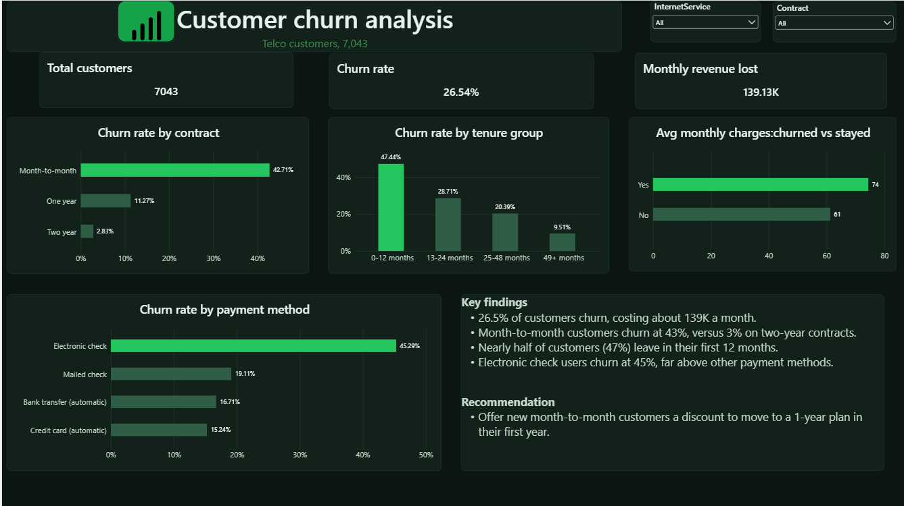

# Customer Churn Analysis

## Objective

Find out why customers leave a telecom company, which customers are most at risk, and what the company can do to keep them.

## Problem

A telecom company loses 26.5% of its customers, which costs about 139K in monthly revenue. The company needs to know who is leaving, when they leave, and what is behind it.

## Dataset

Telco Customer Churn dataset from Kaggle (7,043 customers, 21 columns): https://www.kaggle.com/datasets/blastchar/telco-customer-churn

## Tools

Python (pandas, SciPy), MySQL, Power BI

## Approach

1. Cleaning (Python):** fixed blank `TotalCharges` values and checked for duplicates and missing values.
2. SQL analysis (MySQL):** measured churn by contract type, tenure group, payment method, and service type.
3. Statistical testing (Python, SciPy):** used a chi-square test, a t-test, and correlation to check that the differences were real and not luck.
4. Dashboard (Power BI):** built KPI cards, churn breakdown charts, and slicers for contract and internet service.

## Statistical tests

| Test | Question | Result |
|---|---|---|
| Chi-square | Is contract type linked to churn? | Yes (p < 0.05) |
| t-test | Do churned customers pay more per month? | Yes (p < 0.05) |
| Correlation | Which factor moves most with churn? | Tenure, at -0.35. Shorter tenure means higher churn. |

## Key findings

- 26.5% of customers churn, costing about 139K a month.
- Month-to-month customers churn at 43%, versus 11% on one-year and 3% on two-year contracts. They make up about 87% of the revenue lost.
- 47% of customers leave in their first 12 months. Churn drops to 9.5% after 4 years.
- Electronic check users churn at 45%, against 15% to 19% for other payment methods.
- Churned customers pay about 74 a month, versus 61 for customers who stayed.

In short: the customers who leave are new, on month-to-month contracts, and pay higher monthly bills.

## Recommendation

Offer new month-to-month customers a discount to move to a 1-year plan in their first year. This targets the group that loses the most revenue, at the point where they are most likely to leave.

